<div align="center">


# Apex Grand Prix

**A 3D motorsport game that runs right in your browser — and on your Android phone.**

Open-wheelers, V8 touring cars, turbo street cars and go-karts. Nine tracks (including the Ballarat Highway), three drift tracks and five kart circuits (including a figure-eight with a bridge and an indoor spiral tower) with bridges, tunnels and a city circuit, a full career mode, damage, safety cars, pit stops, hills and rain.

[](https://ws-games.github.io/apex-grand-prix/)
[](https://github.com/WS-Games/apex-grand-prix/releases/latest/download/ApexGP.apk)
[](https://github.com/WS-Games/apex-grand-prix/releases/latest)

<br>


</div>

---

## 🏁 Play

| Platform | How |
|---|---|
| **Browser (PC / Mac / phone)** | Open **[ws-games.github.io/apex-grand-prix](https://ws-games.github.io/apex-grand-prix/)** in Chrome or Edge. On a phone you can tap **⋮ → Add to Home screen** to install it — it then works offline. |
| **Android app** | Download **[ApexGP.apk](https://github.com/WS-Games/apex-grand-prix/releases/latest/download/ApexGP.apk)**, tap it, and allow installing from your browser / files app when asked. Android 7+, fully offline. |

Plug in an **Xbox or PlayStation controller** at any time — it's picked up automatically (with vibration).

## 🆕 New in v1.9.8

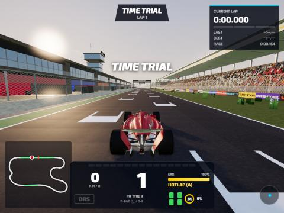

- **Less clutter on every circuit:** about 60% fewer grass tufts and flowers, and about half as many bushes and rocks behind the barriers. The forest is unchanged.
## New in v1.9.7

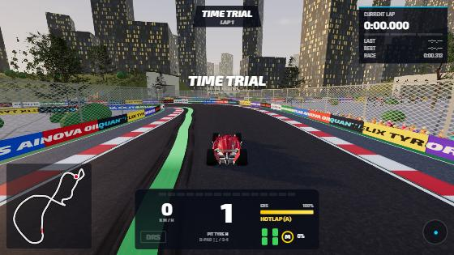
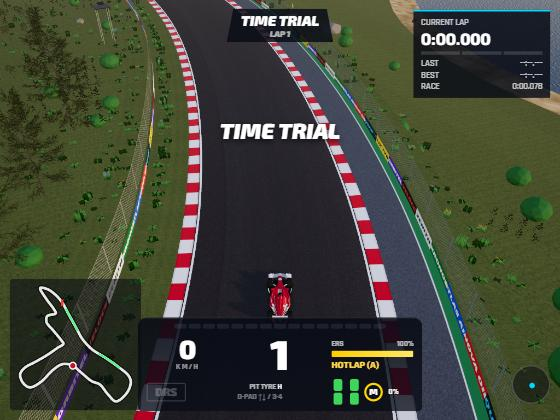
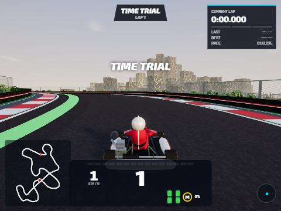

- **Gilded Skyline Grand Prix (new):** a 4.6 km downtown street circuit packed with glass towers, with tunnels and a crossing where the road climbs a hill over a tunnel.
- **Alpine Lake Circuit (new):** a 5.9 km mountain road course with a lake in the middle, tunnels through the hills and a town around the track.
- **Practice Track:** the crossings are now hills over tunnels (no more bridges), and the start line moved to a flat straight.
- **Grass:** grass tufts now stay further from the road and never sit near another part of the track.
## New in v1.9.6

- **Practice Track bridges:** the places where the Practice Track crosses itself are now real bridges. The road climbs over the road below it (at least 4.5 m of clearance), so nothing sits on the track any more. The centre crossing and the loop near the start both use bridges.
## New in v1.9.5

- **Private and public races are separate buttons:** Multiplayer now has "Create private race" (code only, not listed) and "Create public race" (listed in Public Servers). Joining by room code still works.
- **Cleaner menus:** the A / B / Change button hints at the bottom right are gone.
## New in v1.9.4

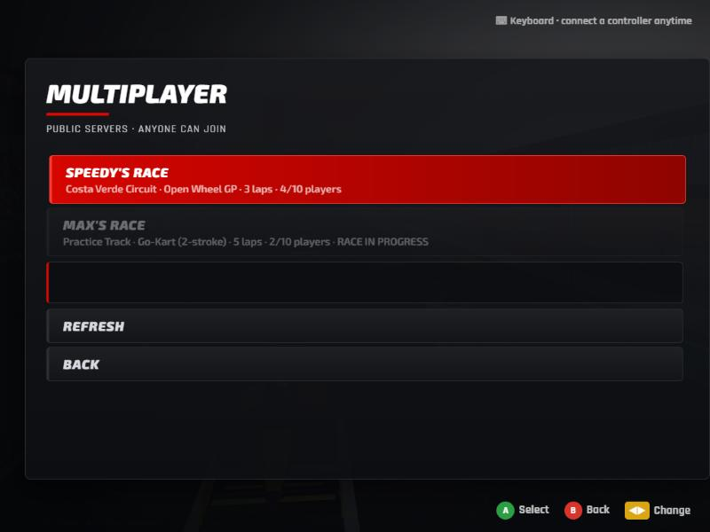

- **Public servers:** anyone can create or join an open online race. Multiplayer → Create race lists your room publicly (switch "Public" off for code-only rooms). Multiplayer → Browse public servers shows host, track, car, laps and player count; click one to join. Full or started races are greyed out, and rooms disappear when the host leaves.
- Rooms are announced through free public MQTT servers (no account or server of ours). Only the room code, host name, track, car class, laps and player count are published. Racing itself is still direct between players, up to 10.
## New in v1.9.3

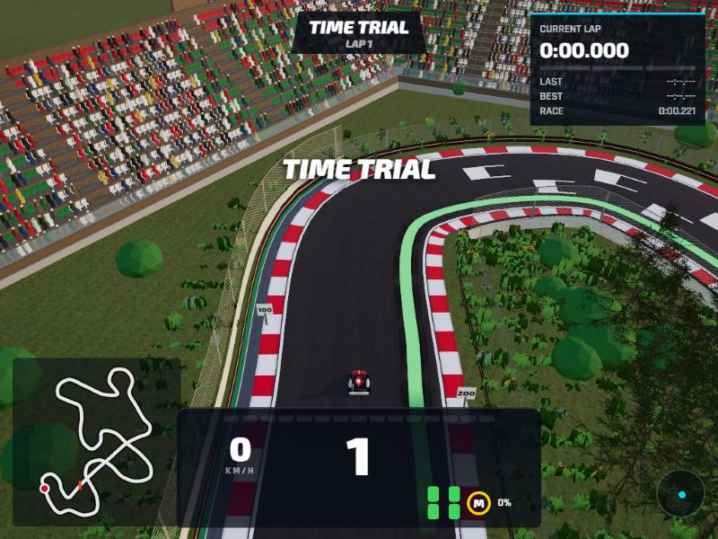

- **Practice Track (karts):** a new relaxed kart circuit with 13 turns and a crossing in the middle, shaped like the practice map. Wide road, good for new players.
- **No more freezing when switching maps:** flicking through circuits and classes in the menu no longer builds the whole forest each time. The full scenery loads when you start the race.
- **Death mode is fairer in race cars and 90s cars:** the computer drivers get a much smaller grip and power boost in touring, GT3 and 90s cars. F1 and karts are unchanged.
## New in v1.9.2 (computers only)

- **GT3 rebuilt**: the GT3 race car now uses a much more detailed model on computers (the torn rear bumper, crumpled panels and distorted rear lights are fixed). Same size, same handling. Phones and the Android app keep the original lighter model.

## 🆕 New in v1.9.1 (computers only)

- **Much better graphics on PC**: real photo-scanned track surfaces (asphalt, grass, gravel, concrete), realistic sky reflections, and detailed buildings on all 17 circuits: stepped grandstands with individual seats and spectators, steel-roofed stands, pit garages with roller doors and a glass hospitality level, and a race control tower. Each circuit has its own colours and building styles.
- **A real forest around every circuit**: about 20,000 scanned trees (real 3D trees up close, baked far-view trees in the distance) right up behind the barriers. Every tree is checked so it never grows through a building, stand, barrier or the track, and trees never overlap each other.
- **Phones and the Android app are unchanged** and keep the lighter graphics, so they run smoothly (the APK on this release is the same v1.9 app).
- **Engine Workshop**: build your own engine (6 layouts, turbo, exhaust, tuning), hear it live, save, load and install it. Every number box can be typed into. Custom engines change the sound only unless you switch on "Engine affects performance". Stock handling is unchanged.
- **Sound**: smoother, cleaner F1 engine (no echo), a pitch drop on upshifts with no pops, rev blips and pops only on downshifts, karts that sound like small petrol engines, and GT3 flames from the real tailpipes.
- **New menu look** across the game, with the red tab bar and WS GAMES branding.
## 🆕 New in v1.9

- **Online races for up to 10 players**: one person creates a room and up to 9 friends join with the code. Everyone gets their own grid slot (host on pole, then in joining order), and the results table lists every player. The host picks the track, car and laps; the race starts when everyone is ready.
- **Smoother online racing**: car positions now go over a fast channel 30 times a second (was 20), late packets are skipped instead of holding up newer ones, and the delay adapts to each player's connection. Other cars glide instead of jumping.
- **Road to Apex GP goes all the way to the top**:
  - **Tier 3 · GT3 Series**: earn the International A licence, buy the GT3 Racer, and race 5 events.
  - **Tier 4 · Apex Grand Prix**: earn the Super Licence, buy the Apex GP Car, and race 5 rounds plus the Grand Final at Big Mama. Win the final to become **Apex Grand Prix Champion**.
  - **Garage upgrades**: Engine, Tyres and Aero, 3 stages each, for every car you own.

## 🆕 New in v1.8.1

- **Joystick steering on phones**: put your thumb anywhere on the left side and slide to steer. Brake and Gas are on the right, plus a Drift button in drift races. Change it in Settings → Touch Steering.
- **Compact landscape HUD on phones**: smaller position board, timing panel, speed panel and start lights, with nothing covering the track.
- Cockpit fixes: the gold shift knob sits on the stick and the instrument hood sits on the dash.

## 🆕 New in v1.8: Online multiplayer

Race a friend over the internet, on computers, phones, or one of each.

**How to play online**
1. Both players open the game (the website or the Android app) and choose **Multiplayer** on the main menu.
2. Player 1 types a name and clicks **Create race**. A 5-letter **room code** appears. Send it to your friend.
3. Player 1 picks the **track**, **car** and **laps**.
4. Player 2 types a name and the code, then clicks **Join race**.
5. Both players click **Ready**, then Player 1 clicks **Start race**.
6. At the end you'll see who won and both finishing times. Choose **Rematch**, **Back to Lobby** or **Main Menu**.

Your opponent appears on track with their name above the car, and the live leaderboard shows both of you. If someone's connection drops, the game reconnects automatically while the host keeps the room open. The host has to keep the game open for the guest to join.

**Also in v1.8**
- A 90s drift-style cockpit for the Supra and S14: coloured roll cage, bucket seat with harness, a row of gauges, a gold shift knob and a 90s dashboard.
- The Japanese street cars steer more easily.
- The 2-stroke kart sounds rougher, like a real 2-stroke.
- No more siren-like engine sound after the finish.
- Fixed a black screen at the end of races on Easy.
- Phones: bigger menus and HUD, tap to go fullscreen, and no accidental zooming. On iPhone, use **Share → Add to Home Screen** to play fullscreen.
- Copyright notice added (see COPYRIGHT.txt).

## 🆕 New in v1.7.1

- **Steering fixed on every car**: less understeer, and more steering lock for hairpins and the kart spiral.
- **Smoother drifting**: drifts no longer gain speed, rotate more gradually and straighten up when you let go. Controller **A** drifts too.
- **Track limits**: going off in a race now gives a +1 s time penalty instead of an invalid lap.
- **Indoor fun park**: a Ferris wheel and a roller coaster in the middle of Spiral Tower Indoor Karting, with gardens, paths, benches, lamps and people walking around.
- **Glass and shadows**: tinted glass in the coupe windows, and soft car-shaped shadows instead of squares.
- **Street and drift cockpit**: you sit higher, the steering wheel is lower, and the shifter sits on the console.

## 🆕 New in v1.7

- **Drift Career**: a new single-player career with its own drift tracks. Hold **Space** (or brake while steering) to kick the car into a slide, steer the angle, use the throttle to hold it, and keep your speed. Points come from angle × speed, with a combo multiplier up to x5. There are six events with Bronze, Silver and Gold targets, and three drift cars. Drift is in Quick Race too.
- **Three drift tracks**: Harbor Drift Yard, Kurogane Touge (a hairpin climb and a fast descent) and the Sunset Coast loop.
- **Japanese street cars**: the Street Turbo class is now MK4-style Supras and S14s, each in its own livery with a number and a sponsor. Drift cars come in black, white, grey or red.
- **Ballarat Highway Circuit (Australia)**: a 5.9 km flat highway loop with three-lane markings, gum trees, roadside buildings, green highway signs, the Burger Barn and a rocky mountain to the north.

| | |
|---|---|
| 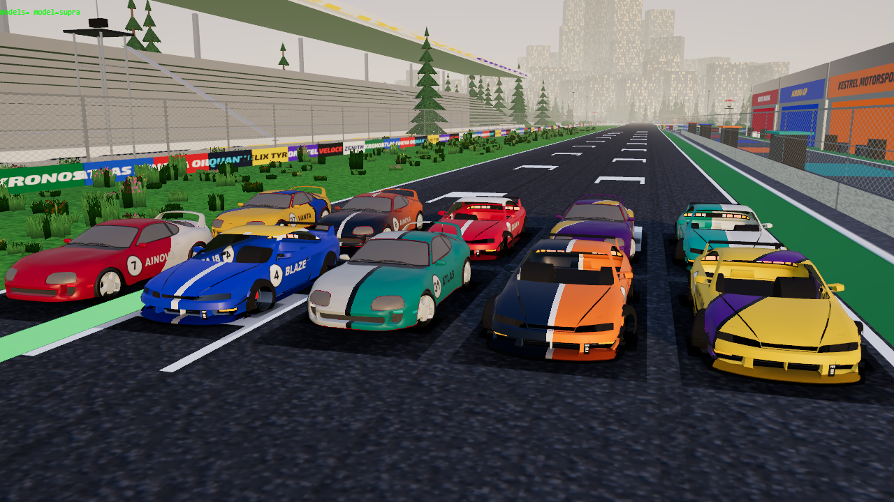 | 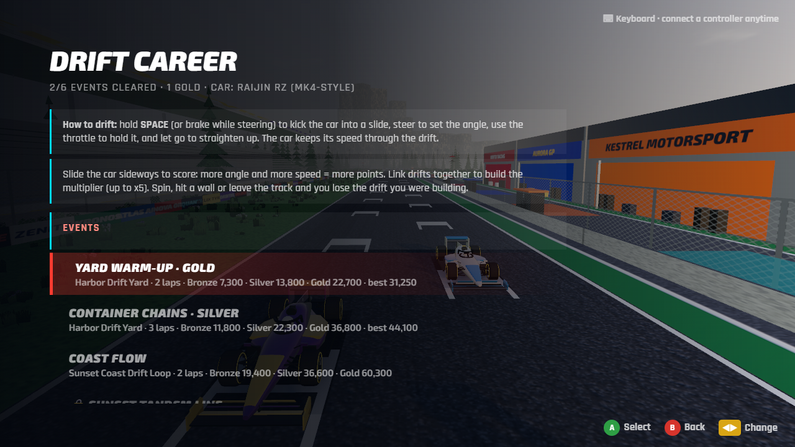 |
| <sub>Street Turbo: Supras and S14s</sub> | <sub>Drift Career</sub> |
| 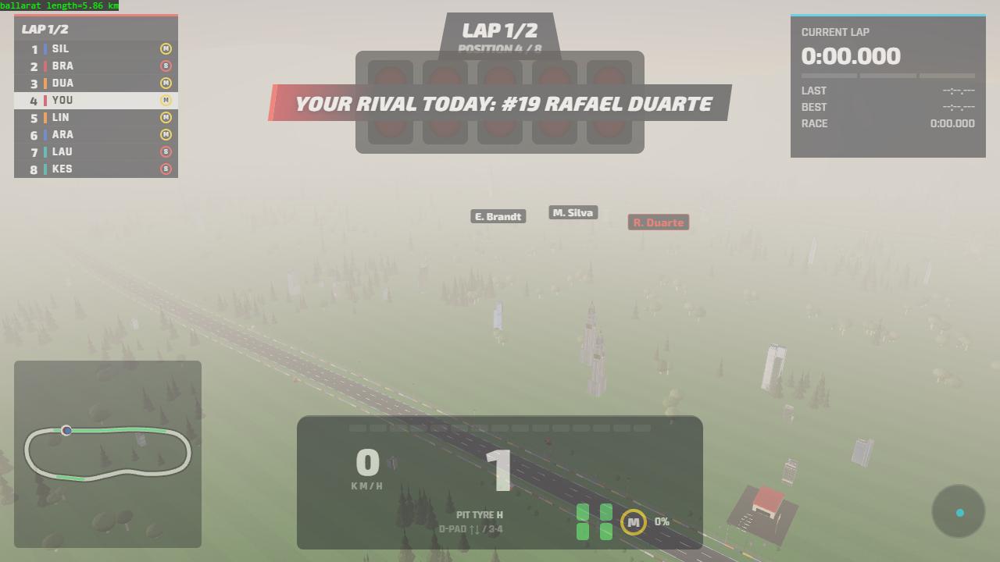 | 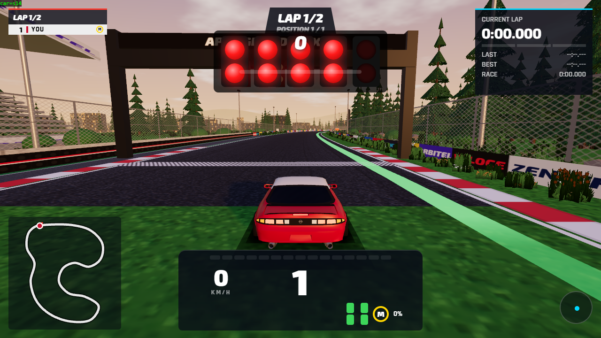 |
| <sub>Ballarat from above: buildings along the highway</sub> | <sub>S14 drift car</sub> |
| 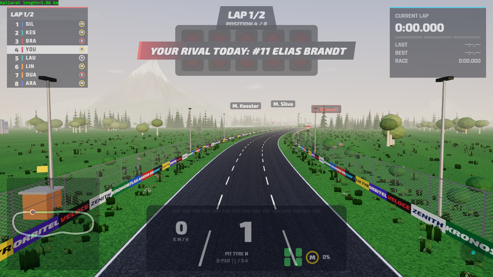 | 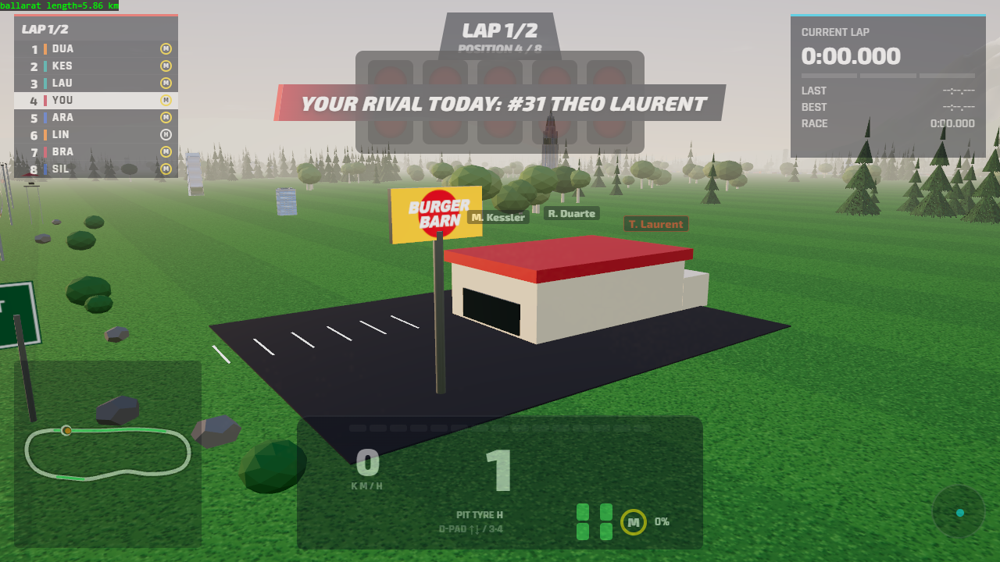 |
| <sub>Ballarat Highway Circuit</sub> | <sub>The roadside Burger Barn</sub> |

## 🆕 New in v1.6.1

- **Save files**: *Save / Load progress to a file* in Settings.
- **A rival every race** — the driver starting next to you is out to beat you: harder racing, fewer mistakes, and a **red name tag**.
- **Driver names over cars** — small tags above nearby cars (toggle in Settings → Gameplay).
- **Race announcer** — a big banner and voice call overtakes at the front, anything involving you or your rival, and the final lap.
- **Tougher AI on every level** — all five levels follow your pace a step closer; Death is quicker than you.
- **Fixes** — no more black screen after winning, GT3 doors are whole with dark race glass, brake and turn at the same time, F1 cockpits are carbon black, a luxury GT3 cockpit with a touchscreen and a digital gauge pod.

| | |
|---|---|
| 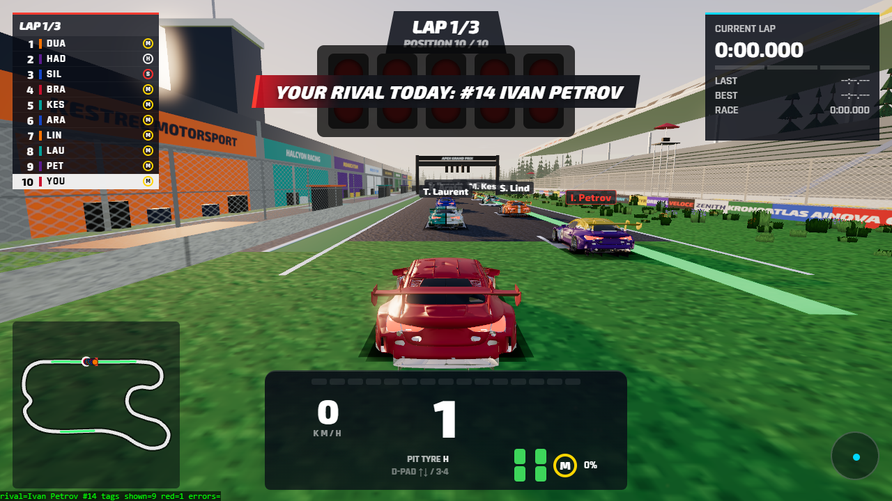 | 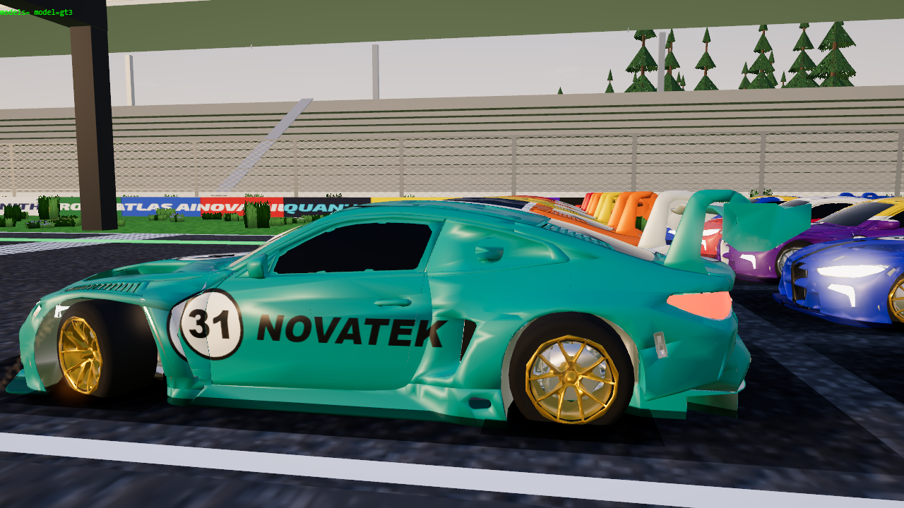 |
| <sub>Your rival (red tag) and driver names</sub> | <sub>GT3: whole doors, race number and sponsor</sub> |
| 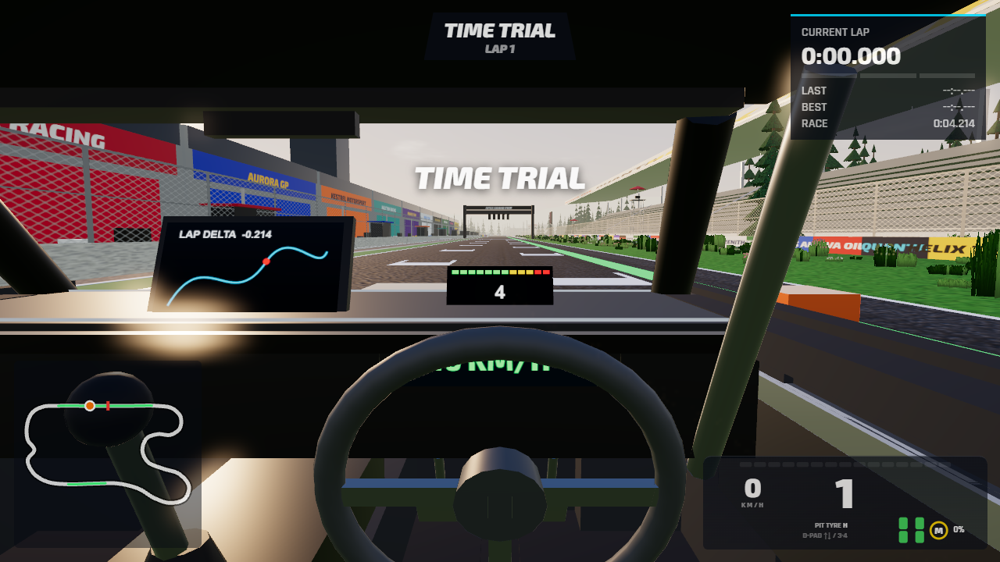 | 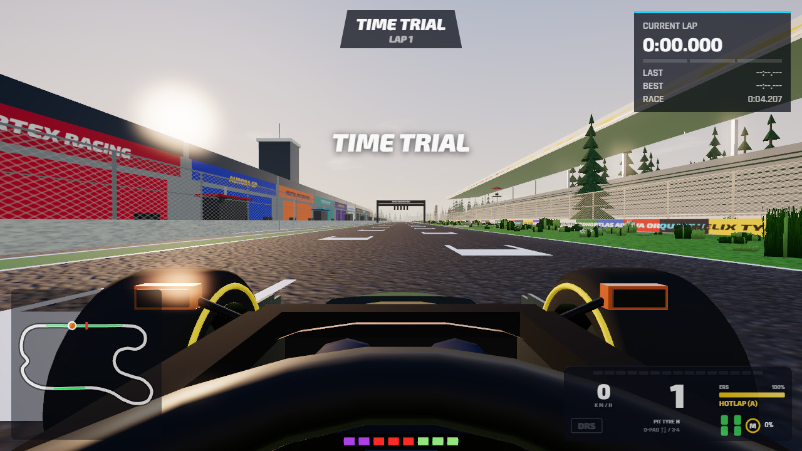 |
| <sub>GT3 cockpit with touchscreen and gauge pod</sub> | <sub>F1 cockpit</sub> |

## 🆕 New in v1.6

- **New race cars** — a 2026-style open-wheeler and a GT3 coupe (3D models credited below), each painted in its own livery with a race number and a sponsor logo, so no two cars look the same. Exhaust flames and pops on lift-off and upshifts, biggest on the open-wheelers.
- **Two new kart tracks** — *Crossover Kart Park*, a figure-eight where the straight dives under a bridge, and *Spiral Tower Indoor Karting*, an indoor arena with a two-turn car-park spiral climbing 8 m.
- **Death difficulty now adapts to you** — it learns how fast you take corners and races at your pace, so every race is wheel-to-wheel. Tidier AI racing lines, less weaving.
- **Sponsors in Road to Apex GP** — win or reach the podium and sponsors make offers: pay per race plus bonuses for hitting their targets, with their logo on your car.
- **Menu previews** — hover over a circuit or a car to see its map or a picture on the right.
- **Handling** — every class is more planted, with no more sliding out of control.
- **Fixes** — the safety car no longer floats (and goes in sooner), kart steering wheel faces the driver, tinted race glass on the GT3, indoor lighting.

| | |
|---|---|
| 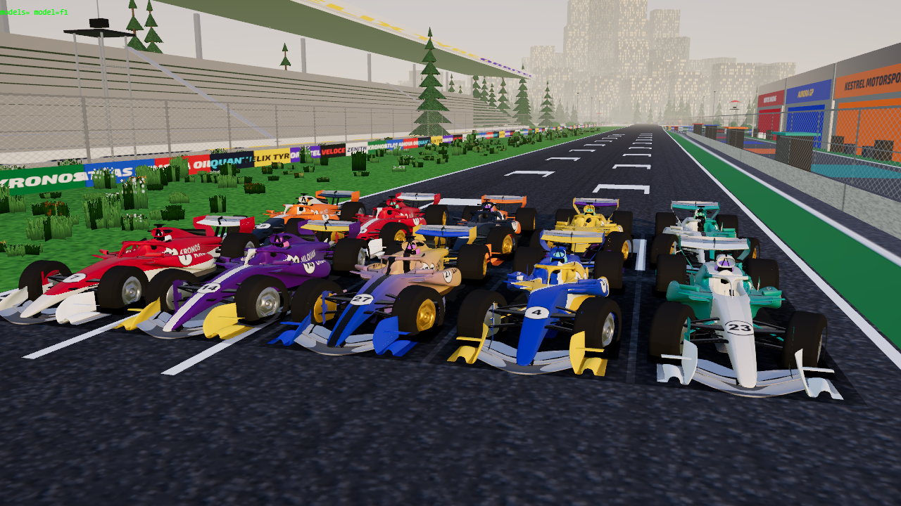 | 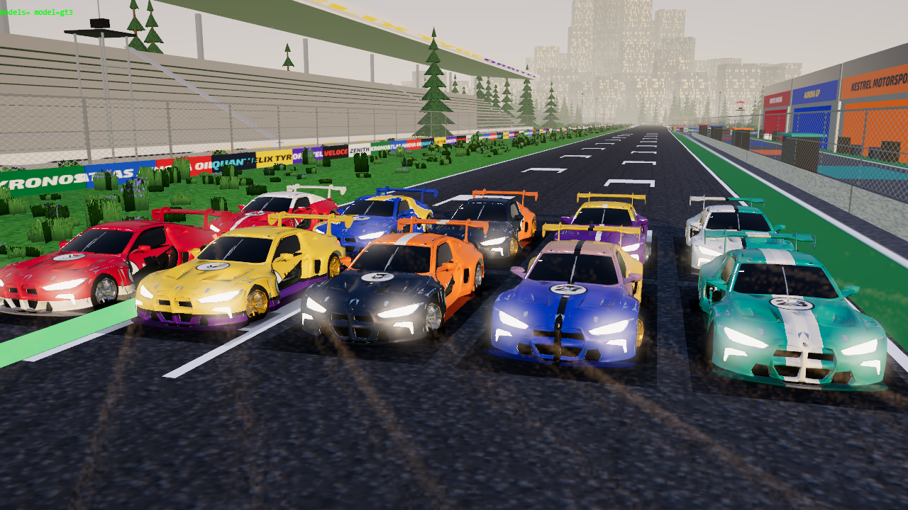 |
| <sub>New open-wheelers: every car has its own livery, number and sponsor</sub> | <sub>New GT3 cars</sub> |
| 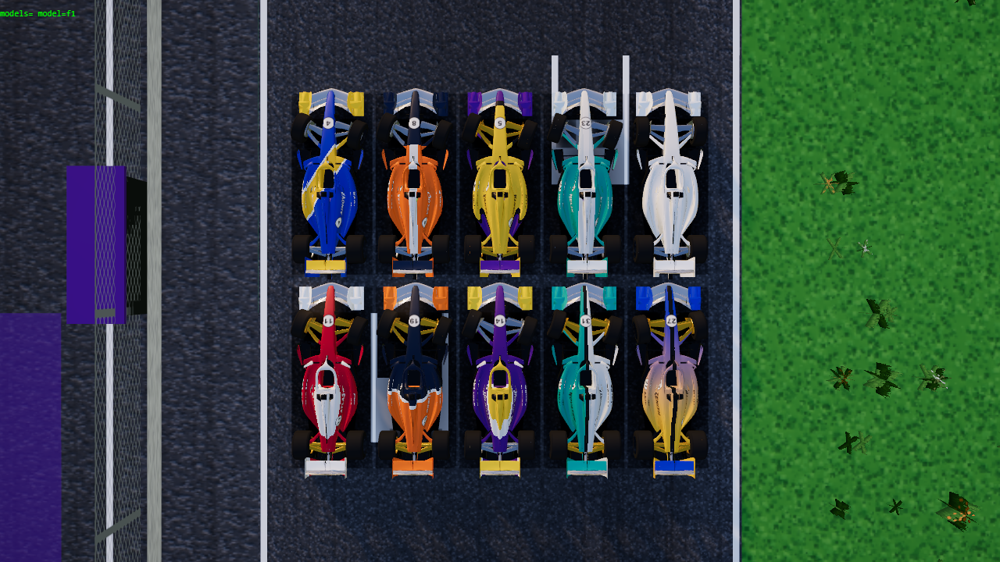 | 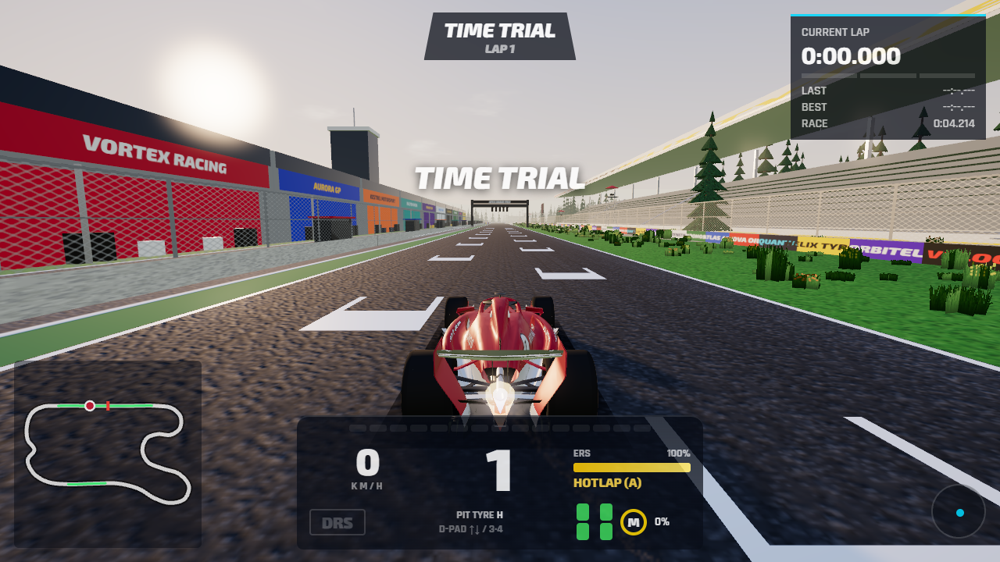 |
| <sub>From above</sub> | <sub>Third person, with exhaust flames</sub> |
| 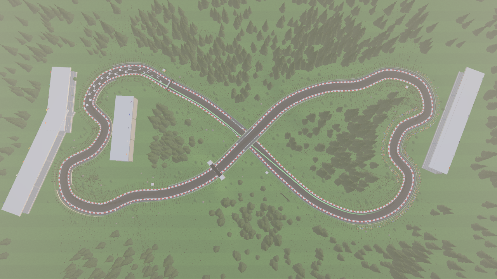 | 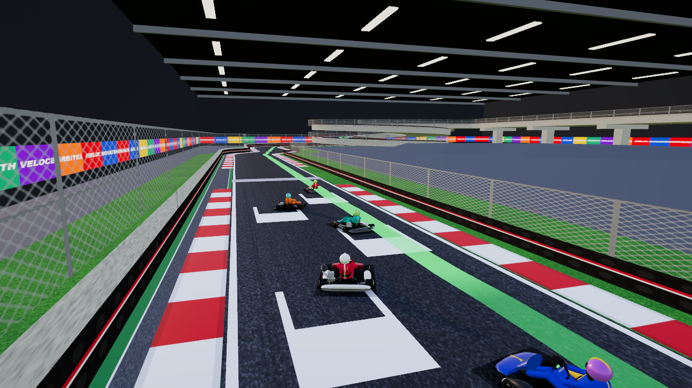 |
| <sub>Crossover Kart Park: figure-eight over a bridge</sub> | <sub>Spiral Tower Indoor Karting</sub> |
| 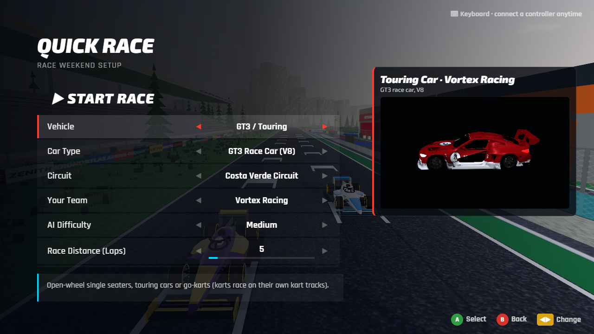 | 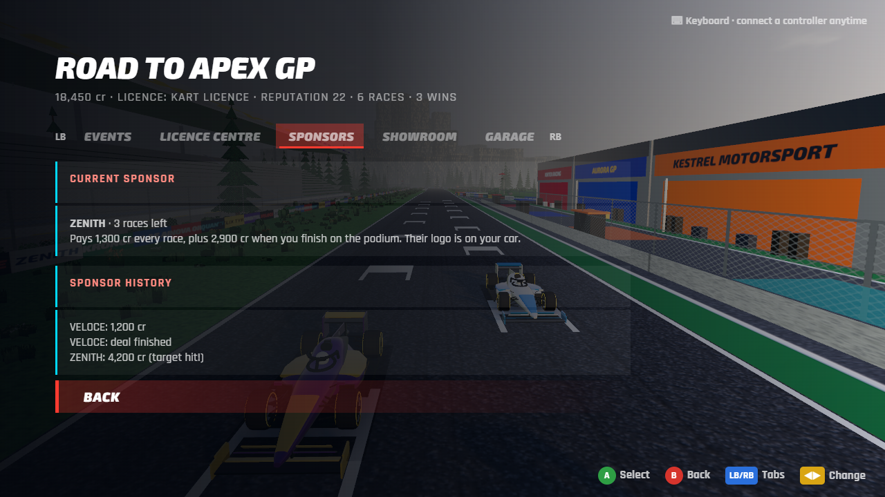 |
| <sub>Hover previews in the menus</sub> | <sub>Sponsors in Road to Apex GP</sub> |

## 📸 Screenshots

<table>
  <tr>
    <td></td>
    <td></td>
  </tr>
  <tr>
    <td align="center"><sub>Golden hour at Costa Verde</sub></td>
    <td align="center"><sub>V8 touring cars at Mount Kestrel</sub></td>
  </tr>
  <tr>
    <td></td>
    <td></td>
  </tr>
  <tr>
    <td align="center"><sub>Lakeside Park chicane from the TV camera</sub></td>
    <td align="center"><sub>Career mode: pick your championship</sub></td>
  </tr>
  <tr>
    <td></td>
    <td></td>
  </tr>
  <tr>
    <td align="center"><sub>Main menu</sub></td>
    <td align="center"><sub>TV broadcast camera</sub></td>
  </tr>
  <tr>
    <td></td>
    <td></td>
  </tr>
  <tr>
    <td align="center"><sub>Heavy rain — spray, wet track, full wet tyres</sub></td>
    <td align="center"><sub>First person cockpit</sub></td>
  </tr>
  <tr>
    <td></td>
    <td></td>
  </tr>
  <tr>
    <td align="center"><sub>Helicopter cam over the pit straight</sub></td>
    <td align="center"><sub>Settings — assists, gameplay, display, audio, controls</sub></td>
  </tr>
</table>

<div align="center">
<br>
<sub>On a phone: steering buttons, pedals, DRS and ERS overtake — or steer with the swipe slider or by tilting</sub>
</div>

## ✨ Features

**Road to Apex GP** — a ladder career: start in a rental kart, pass graded licence tests (Bronze / Silver / Gold), race Kart Club and Street Turbo events for prize money, and buy your way up to faster cars. Pick your assists and difficulty before every event.

**Career mode** — pick a championship, sign for a team and race a full season with points, standings and saved progress:

| Championship | Vehicle | Calendar |
|---|---|---|
| 🏎️ **Apex GP World Championship** | Open-wheel single seaters (DRS, ERS) | Lakeside Park → Costa Verde → Nordhavn Ring → Mount Kestrel |
| 🚗 **Endurance Touring Series** | 1300 kg V8 touring cars | Costa Verde → Lakeside Park → Nordhavn Ring → Harbour Viaduct → Granite Pass → **Mountain 1000** finale |
| 🛞 **Kart Championship** | 2-stroke or 4-stroke go-karts | Valle Verde → Rocca → Westfield (kart-only circuits) |
| 🏁 **Street Turbo Cup** | 90s twin-turbo street coupes | Nordhavn Ring → Lakeside Park → Costa Verde → Harbour Viaduct → Granite Pass |

**Eight tracks**

| Track | Type | |
|---|---|---|
| Costa Verde Circuit | Grand prix circuit | 4.3 km, fast sweepers and a hairpin |
| Nordhavn Ring | Grand prix circuit | 3.8 km, technical |
| **Lakeside Park Circuit** | Park street circuit | 3.6 km, three chicanes, walls close to the track |
| **Mount Kestrel Raceway** | Mountain circuit | 5.1 km, 147 m of climb, twisty summit and a 1.7 km downhill straight |
| **Harbour Viaduct Circuit** | Figure of eight | 4.8 km, a 1 km cable-stayed viaduct 13 m over the track below, and a tunnel under the hill |
| **Granite Pass Circuit** | Mountain circuit | 5.1 km, a 470 m tunnel with turns inside, then a viaduct over the climb |
| **Metropolis Grand Prix** | City circuit | 7.7 km through skyscrapers: harbour street section, dark tunnel, mountain climb, viaduct crossover |
| **Valle Verde / Rocca / Westfield** | Kart circuits (karts only) | 0.95–1.35 km, tyre walls, tight hairpins and fast sweepers |
| **Big Mama** | Fan-designed | 8.3 km round a lake: tunnel, a raised turn 10 m up, a self-crossing loop, city, forest and a rocky mountain |

**Racing**
- 🤖 **19 AI rivals** on five levels — Easy, Medium, Hard, Very Hard and **Death** (flat-out, no mistakes, late braking, hard defending). They overtake, defend, use DRS/ERS and make their own pit stops
- 📻 **Rival team radio** — men and women drivers yell (and swear) at you when you hit them, pass them or hold them up. Voice + text, text only, clean or off
- 🚦 **Race weekend feel** — five-light starts, sector times (purple / green / yellow), fastest laps, chequered flag and points
- 🛞 **Tyre strategy** — Soft, Medium, Hard, Intermediate and Full Wet, with wear that costs grip
- 🔧 **Pit stops** — dive into the pit lane, the car drives the 80 km/h limiter to your garage and fits fresh tyres
- ⚡ **DRS & ERS** — DRS within a second of the car ahead; four ERS modes with a battery that recharges under braking
- 🌧️ **Weather** — dry, light rain, heavy rain: spray, wet reflections, fog and much less grip on slicks
- 💥 **Damage** — hits knock off wings and bumpers, cost grip and power and make the engine smoke; a big crash destroys the car; pit to repair
- 🚨 **Safety car** — comes out when a car is wrecked on track: no overtaking until it pulls in
- 🧠 **AI personalities** — every driver has their own attacking, defending, corner speed, consistency and mistakes

**Driving**
- Car physics with downforce, weight transfer, tyre grip, and hills (gravity on climbs and descents, getting light over crests)
- 🛞 **Go-karts** — light, fast, laid-back karts with a 2-stroke (chainsaw scream) or 4-stroke (thumper) engine, on their own kart circuits
- Vehicle classes with their own handling, gearbox and engine sound: open-wheel (real F1 engine recording, 8 gears), touring race car (V8, 6 gears) and turbo street coupe; a grid of different body styles
- Full assists like the big racing games: stability control, steering, braking, ABS, traction control, racing line, DRS and ERS
- **9 cameras** — T-Cam, cockpit, helmet, nose, rear wing, third person, far chase, helicopter and TV broadcast, plus free look

**World**
- Eight original tracks, every one on the edge of a city skyline: grand prix circuits, a park street circuit, mountain circuits, a figure of eight, a skyscraper city circuit and a fan-designed lake circuit
- Grandstands with flags, team garages and paddock, TV camera towers, a live timing big screen, bridge, floodlights, marshal posts, distance boards, rubbered-in racing line and skid marks
- Detailed cars: wings with working DRS flap, halo, steering wheel, glowing brake discs, team liveries and race numbers
- Early-morning light with height fog and sun shafts through the pine forests
- Five menu songs to pick from (synthwave, hard rock, drum & bass, eurobeat, phonk)

## 🎮 Controls

| Action | Controller | Keyboard | Touch |
|---|---|---|---|
| Steer | Left stick | A / D or ← / → | ◀ ▶ · slider · tilt |
| Throttle / Brake | RT / LT | W / S or ↑ / ↓ | GAS / BRAKE |
| Shift up / down (manual) | RB / LB | E / Q | + / − |
| DRS | A | Space | DRS |
| ERS overtake (hold) | B | F | OT |
| ERS mode | D-pad ← / → | 1 / 2 | — |
| Pit tyre choice | D-pad ↑ / ↓ | 3 / 4 | — |
| Change camera | X | C (V = previous) | CAM |
| Look around / back | Right stick / Y | Z, X / B | — |
| Reset car to track | View | R | — |
| Pause | Menu | Esc | ❚❚ |

> **Pitting:** drive into the pit lane on the **left**, just before the start/finish line. Choose your next tyre first with the D-pad (or 3 / 4).

## 🛠️ Tech

- One self-contained `index.html` — HTML, CSS and JavaScript using [three.js](https://threejs.org/) r160 for 3D. No build step.
- Everything is generated in code: track geometry from splines, cars from lofted shapes, textures drawn on canvas, audio synthesised with the Web Audio API.
- Installable web app (`manifest.json` + `sw.js` service worker) when served over HTTPS, e.g. GitHub Pages.
- `android/` is a small WebView app that serves the game from the APK, so it runs offline.

### Building the APK

The build script uses the Android SDK tools directly (no Gradle):

```powershell
powershell -ExecutionPolicy Bypass -File android\build-apk.ps1
```

It needs JDK 17, Android SDK platform 34 + build-tools 34.0.0, and three.js 0.160 (`three.module.js`, `BufferGeometryUtils.js`) — paths are set at the top of the script. On first run it creates a signing key, `android/apexgp.keystore`, which is git-ignored: back it up, because updates to an installed app must be signed with the same key.

### Project layout

```
index.html              the whole game
sw.js, manifest.json    offline / installable web app
icon-192.png, icon-512.png
Play Apex GP.bat        Windows launcher
android/                Android WebView app + build script
docs/screenshots/       images used in this README
```

## 🙏 Credits

- F1 engine sound: ["BCR F1 Car 19"](https://freesound.org/s/77919/) by **LG**, licensed [CC BY 4.0](https://creativecommons.org/licenses/by/4.0/) (trimmed and re-pitched).
- Crowd sound: ["F1 Crowd Air Horns"](https://freesound.org/s/200809/) by **WebbFilmsUK**, licensed [CC BY 4.0](https://creativecommons.org/licenses/by/4.0/) (trimmed).
- Open-wheel car model: ["2026 F1 Car new EVO"](https://skfb.ly/pMqnE) by **Abu Saif**, licensed [CC BY 4.0](http://creativecommons.org/licenses/by/4.0/) (reduced in detail, recoloured with in-game liveries, new tyres).
- GT3 car model: ["2026 M4 GT3 EVO"](https://sketchfab.com/3d-models/bmw-m4-gt3-evo-2bb94e090bdb4df28ac34bc50df51d19) by **VTDAT23**, licensed [CC BY 4.0](http://creativecommons.org/licenses/by/4.0/) (reduced in detail, badges and decals removed, recoloured with in-game liveries). Not affiliated with or endorsed by any car maker.
- Street/drift car (MK4-style): ["Toyota Supra MK4 (LowPoly)"](https://sketchfab.com/3d-models/36e53ad2f8f04e819baf5519dcb1bf7a) by **Mike Farrant**, licensed [CC BY 4.0](http://creativecommons.org/licenses/by/4.0/) (badges removed, repainted with in-game liveries).
- Street/drift car (S14-style): ["Nissan Silvia S14"](https://skfb.ly/oSSxs) by **S.K.**, licensed [CC BY 4.0](http://creativecommons.org/licenses/by/4.0/) (repainted with in-game liveries).
- Roadside buildings on the Ballarat Highway Circuit: ["Low-poly City Buildings"](https://skfb.ly/oMrLu) by **smooth998**, licensed [CC BY 4.0](http://creativecommons.org/licenses/by/4.0/).
- Track textures from [Poly Haven](https://polyhaven.com) (CC0): "Asphalt Track", "Asphalt Pit Lane" and "Gravel" by Dimitrios Savva, "Grass Ground" by Charlotte Baglioni, "Brushed Concrete" by Dario Barresi and Dimitrios Savva.
- Sky reflections from the Poly Haven HDRI "Kloofendal 48d Partly Cloudy (Pure Sky)" by Greg Zaal and Jarod Guest (CC0).
- Trees from Poly Haven (CC0): "Tree Small 02" by Rico Cilliers and "Fir Sapling Medium" by Rob Tuytel and Rico Cilliers (simplified for the browser).
- None of the car or building models are affiliated with or endorsed by any manufacturer or brand.
- Everything else (the other cars, tracks, textures, music, other sounds, sponsor names) is generated in code.

## © Copyright

© 2026 **WS Games**. All rights reserved. You may play Apex Grand Prix for free, but you may not copy, redistribute or sell the game without permission. Third-party models and sounds keep their own CC BY licences (see Credits). Details in [COPYRIGHT.txt](COPYRIGHT.txt).
